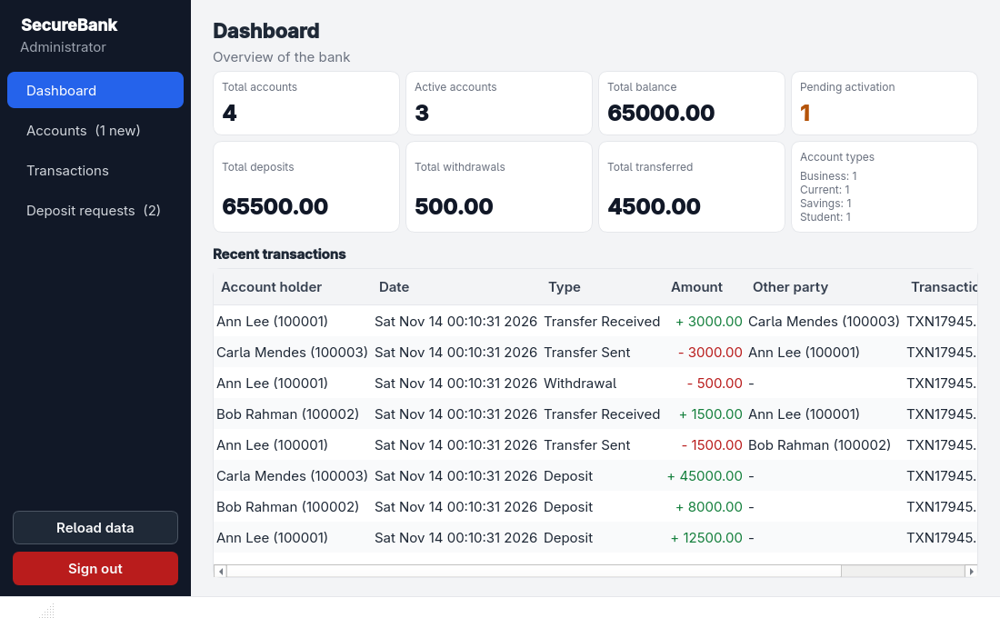
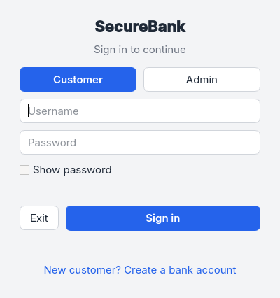
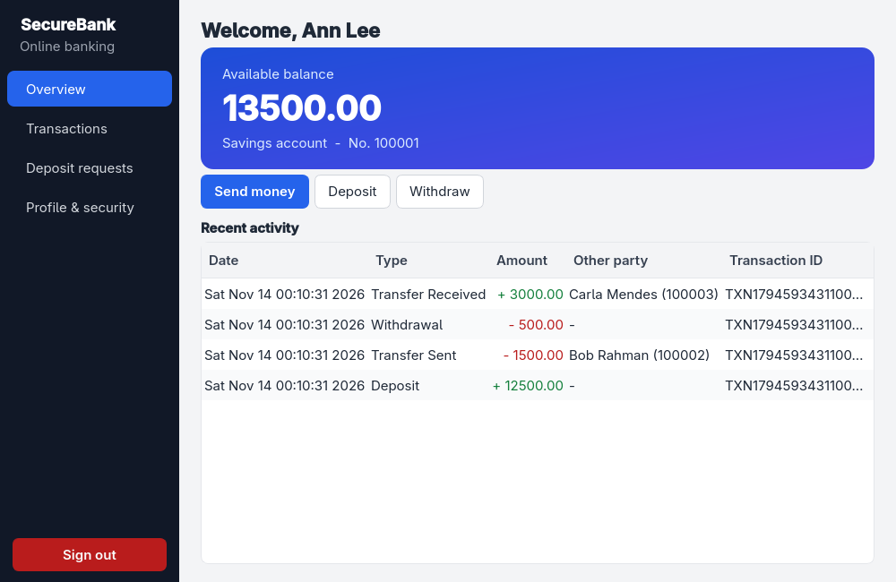
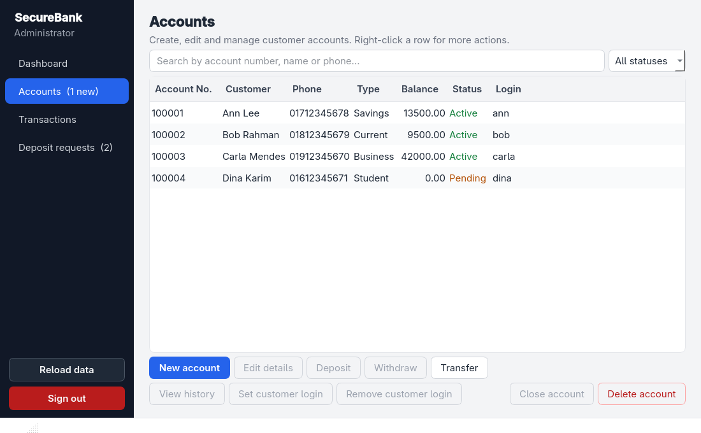
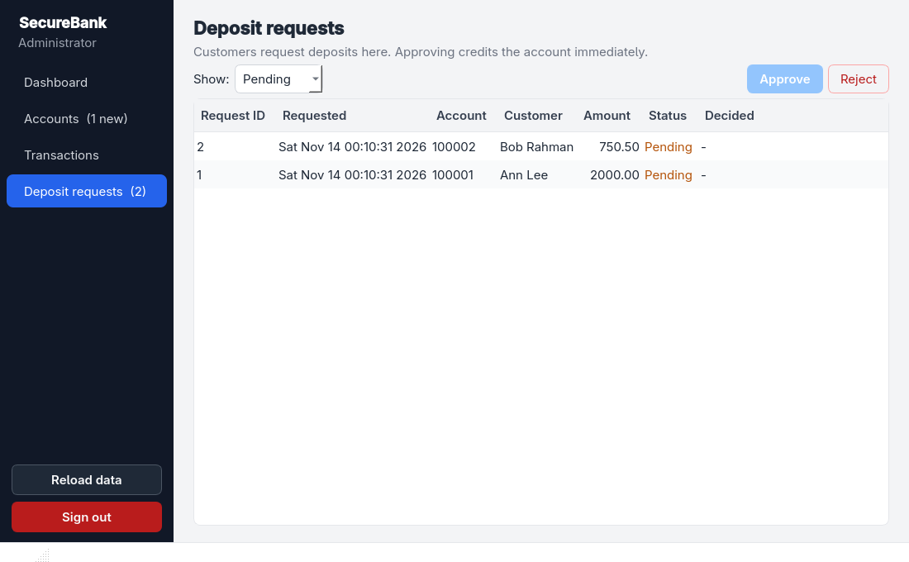
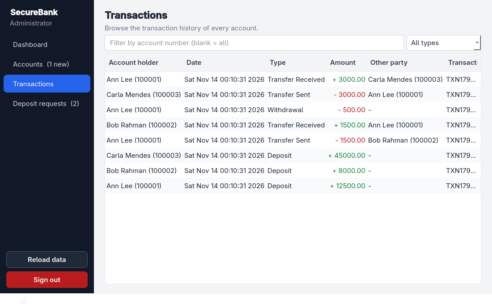
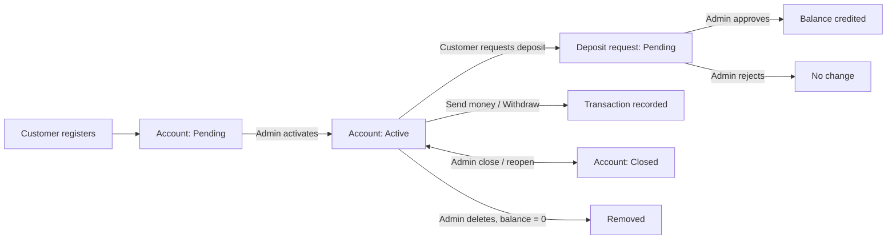

<div align="center">

# 🏦 SecureBank

**A modern banking management system in C++17 — with a Qt6 desktop app and a classic console mode.**




</div>

---

## ✨ Highlights

- 👤 **Two roles** – Administrator and Customer, each with its own dashboard
- 📝 **Self-registration** – customers open an account themselves; an admin activates it
- 💸 **Safe money movement** – transfers verify the receiver's name, withdrawals ask for your password
- ✅ **Approval workflow** – customer deposits are credited only after admin approval
- 🧾 **Clear history** – every transaction shows the account holder's **name and ID**
- 🛡️ **Validated everywhere** – names, phones, usernames, passwords and amounts are checked
- 💾 **No database needed** – human-readable text files, integer-paisa money (no rounding errors)

## 🚀 Quick Start

```bash
# 1. Install the dependencies (Debian/Ubuntu)
sudo apt install build-essential cmake qt6-base-dev

# 2. Build and run the GUI
./run_gui.sh
```

Sign in as **Admin** with `admin` / `admin123`, or click **"New customer? Create a bank account"** to register as a customer.

> [!TIP]
> Prefer the terminal? Run `./run.sh` for the console version (admin only, no Qt required).

## 📸 Screenshots

| Sign in | Customer overview |
|:---:|:---:|
|  |  |

| Accounts | Deposit requests |
|:---:|:---:|
|  |  |

<details>
<summary>Transactions (admin)</summary>



</details>

## 🧭 How It Works



### 👑 Administrator

| Area | What you can do |
|------|-----------------|
| **Dashboard** | Totals for accounts, balance, deposits, withdrawals and transfers; account-type breakdown; recent transactions |
| **Accounts** | Create, edit, search, filter, close, reopen, **delete**, **activate**; deposit / withdraw / transfer for a customer |
| **Customer logins** | Create, reset or remove a customer's username and password |
| **Deposit requests** | **Approve** (credits the account) or **Reject** pending requests |
| **Transactions** | Browse all transactions, filter by account and type |

Tips: double-click an account to edit it, right-click for more actions, and use **Reload data** in the sidebar to re-read the files.

### 🙋 Customer

| Area | What you can do |
|------|-----------------|
| **Overview** | Balance, recent activity, **Send money**, **Deposit**, **Withdraw** |
| **Transactions** | Full history (green `+` incoming, red `-` outgoing) with a type filter |
| **Deposit requests** | Track your requests: Pending, Approved or Rejected |
| **Profile & security** | View account details, change phone number and password |

### 🔐 Money rules

| Action | Rule |
|--------|------|
| **Send money** | Enter the receiver's account number **and name**. They must match the account holder (case-insensitive) or the transfer is refused. You confirm before it is sent. Both accounts must be active and the balance sufficient. |
| **Withdraw** | Amount **+ your password**. A wrong password cancels it; 3 wrong passwords sign you out. A confirmation pop-up appears on success. |
| **Deposit (customer)** | Creates a request (max 10 pending). The balance changes only when an admin approves. |
| **Deposit (admin)** | Credited immediately. |
| **Delete account** | Admin only; balance must be 0 and the account number must be typed to confirm. |

## ✅ Input Validation

Enforced in the dialogs for instant feedback **and** again in `BankService`.

| Input | Rule |
|-------|------|
| Name | 1–50 characters: letters, spaces, `.`, `-`, `'` |
| Phone | 7–15 digits |
| Username | 3–20 characters: letters, digits, `_`, `.`; unique (case-insensitive) |
| Password | 6–64 characters, no spaces or `\|`; a new password must differ from the old one |
| Amount | Positive, max 2 decimals, up to **100,000,000.00** per transaction |
| Account type | Savings, Current, Student, Business |

## 🛠️ Build & Run in Detail

<details>
<summary><b>GUI (Qt6)</b></summary>

```bash
cmake -S . -B build/cmake -DCMAKE_BUILD_TYPE=Release
cmake --build build/cmake -j"$(nproc)"
./build/cmake/securebank_gui        # run from the project root
```

The app looks for a `data/` folder in the current directory (or next to `build/`) and creates it when missing.
On **Windows**, build with CMake and a Qt 6 kit (Qt Creator, or `cmake -DCMAKE_PREFIX_PATH=<path to Qt>`).
If Qt 6 is not found, the GUI target is skipped and only the console app is built.

</details>

<details>
<summary><b>Console version</b></summary>

Linux:

```bash
./run.sh
```

Windows PowerShell:

```powershell
Set-ExecutionPolicy -Scope Process Bypass
.\run.ps1
```

Compiles `src/*.cpp` with `-std=c++17 -Wall -Wextra -pedantic`. The admin credentials are the same as in the GUI.
The console version does not support customer login, pending accounts or deposit approval.

</details>

<details>
<summary><b>Run the tests</b></summary>

```bash
./test.sh          # Linux
.\test.ps1         # Windows PowerShell
```

Covers balance rules, account/transaction file round trips, malformed and duplicate records, and field validation.
A manual GUI checklist is in [docs/testing.md](docs/testing.md).

</details>

## 🗂️ Project Structure

```text
.
├── CMakeLists.txt          Console (securebank) + GUI (securebank_gui) targets
├── run_gui.sh              Build and run the Qt6 GUI
├── run.sh / run.ps1        Build and run the console version
├── test.sh / test.ps1      Build and run the automated tests
├── src/
│   ├── main.cpp            Console entry point
│   ├── Account.*           Account model and balance rules
│   ├── BankSystem.*        Console workflows
│   ├── FileManager.*       Loading and saving accounts / transactions
│   └── gui/
│       ├── main_gui.cpp    GUI entry point (sign in → window → sign out)
│       ├── LoginDialog.*   Customer / Admin sign-in and registration
│       ├── AdminWindow.*   Admin dashboard, accounts, transactions, deposits
│       ├── CustomerWindow.* Customer overview, history, deposits, profile
│       ├── Dialogs.*       Reusable validated dialogs and table helpers
│       ├── BankService.*   Business rules, validation, logins, deposit requests
│       └── Theme.h         Stylesheet and UI helpers
├── tests/test_main.cpp     Automated tests (Account, FileManager)
├── data/                   Runtime data (git-ignored)
└── docs/                   Design, data format, testing, limitations, screenshots
```

```text
AdminWindow / CustomerWindow / LoginDialog    ← Qt widgets
                 │
            BankService                       ← rules, validation, logins, deposit requests
                 │
         Account + FileManager                ← shared with the console version
                 │
             data/*.txt
```

## 💾 Data Files

Stored in `data/` (created on first use, **git-ignored** because they contain personal data and password hashes).

| File | Format |
|------|--------|
| `accounts.txt` | `account_number\|name\|phone\|type\|balance\|status` |
| `transactions.txt` | `id\|account\|type\|amount\|date_time\|related_account` |
| `customers.txt` | `account_number\|username\|salt\|sha256_hash` |
| `deposit_requests.txt` | `id\|account\|amount_paisa\|requested_at\|status\|decided_at` |

Statuses: accounts are `Active`, `Closed` or `Pending`; deposit requests are `Pending`, `Approved` or `Rejected`.
Deleting an account removes the account, its login and its deposit requests; past transactions stay for auditing
(shown as "Deleted account" in the history). Details: [docs/data-format.md](docs/data-format.md).

## 🔒 Security Notes

> [!WARNING]
> SecureBank is an educational project, not production banking software.

- Customer passwords are stored as **salted SHA-256 hashes**, never in plain text.
- The admin credentials (`admin` / `admin123`) are **hard-coded** in `src/gui/LoginDialog.cpp` and `src/main.cpp` — change them before any real use.
- A production system should use a slow password hash (bcrypt / Argon2) and a real database.

## 📚 Documentation

- [System design](docs/system-design.md)
- [Data format](docs/data-format.md)
- [Testing](docs/testing.md)
- [Known limitations](docs/limitations.md)

## ⚠️ Known Limitations

- Text-file storage; two running instances can overwrite each other's changes (data is re-read on sign-in, page changes and *Reload data*).
- A single hard-coded admin account; no password recovery (an admin resets customer logins).
- No interest, loans, cards or per-admin audit trail.
- The console version lacks customer login, pending accounts and deposit approval.
